# Assembly - Spenser - a developer's companion v1.0.0

## Assembly

Two lanes, one for dark chocolate and one for milk. Everything marked **2x** is done once for each lane.

Print the [3D parts](hardware-3ddesign.md), buy the [electronics](hardware-bom.md), and put the [firmware](firmware.md) on the controller first.

These drawings were made from the parts' 3D models, not photographed from a finished unit. If something here does not match what is in your hands, please [tell us](https://github.com/costateixeira/spenser/issues).

Check that you have everything. The horns and screws come with the servos, and you also need a USB-C cable. A piece of chocolate must be no larger than 60 × 39 mm, and between 5.5 and 7.5 mm thick.

1
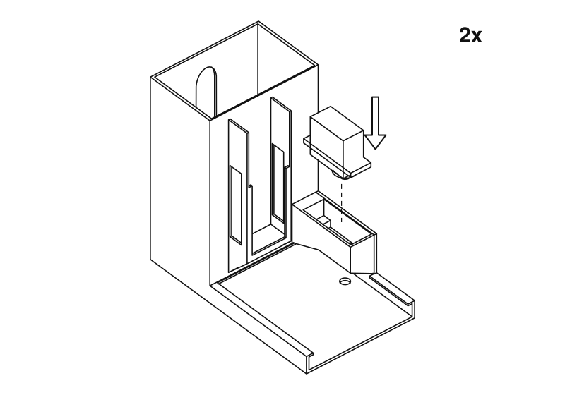
Lower the servo into the box, shaft down, until its ears rest on the ledge. The shaft points at the tray.

2
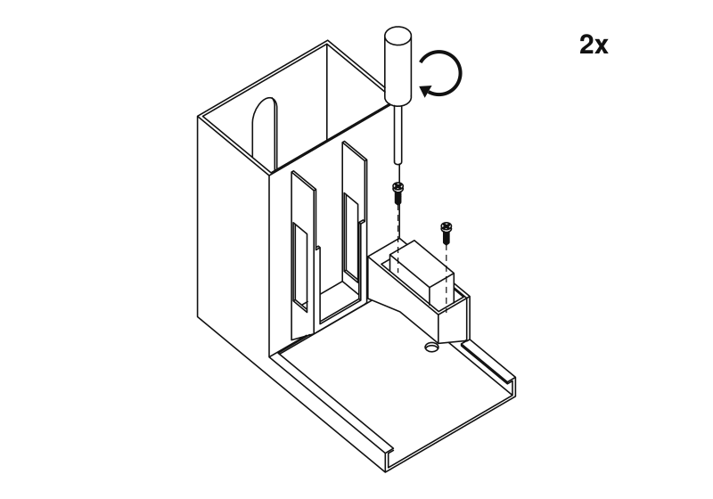
Fix it with two screws through the ears. Snug, not tight: they are going into plastic.

3
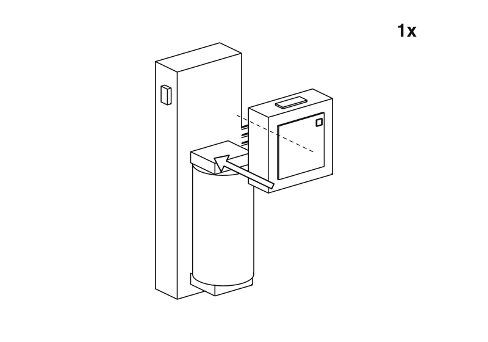
Press the Atom onto the end of the Atomic Motion base away from the battery.

4
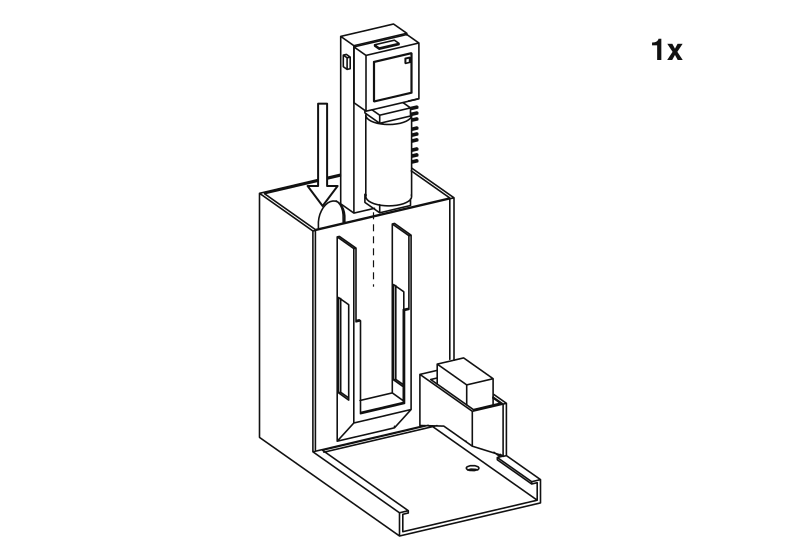
Slide the base down into the bay on the front of one tower, battery end first, so the Atom ends up at the top. The battery and the Atom's button face the tray, and the servo headers are on the side towards the servo. Only one body needs it.

5
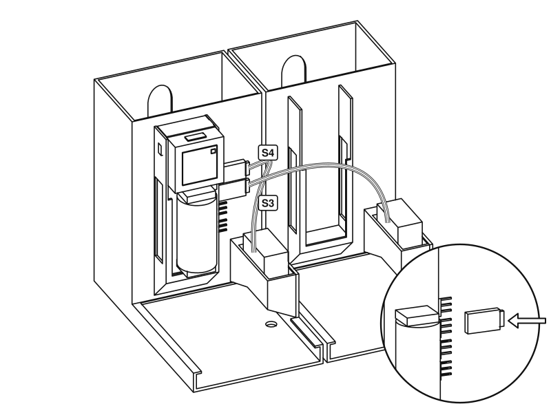
Stand the bodies side by side. Push the dark lane's servo plug onto the header marked S4 and the milk lane's onto S3, which the firmware calls channels 3 and 2. The brown wire is ground: match it to the ground mark beside the header. A different choice can be set on the dashboard.

6
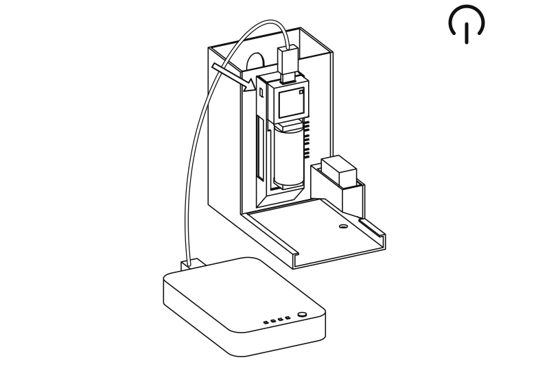
Plug the power bank into the USB-C port on top of the Atom and switch the base on. Open the dashboard and press
**Move both to rest**. Do not turn the servos by hand from now on. The base's own battery charges from the same cable.

7
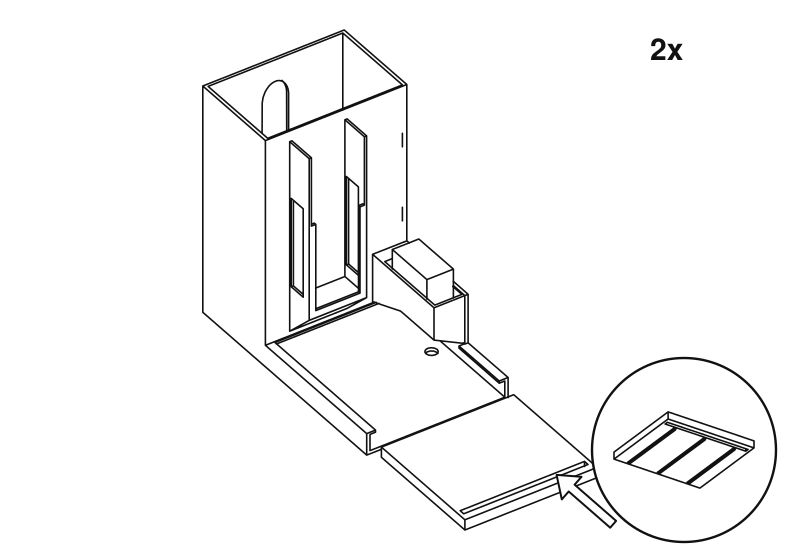
Slide the pusher into the channel from the front, ribs down and the long slot towards you.

8
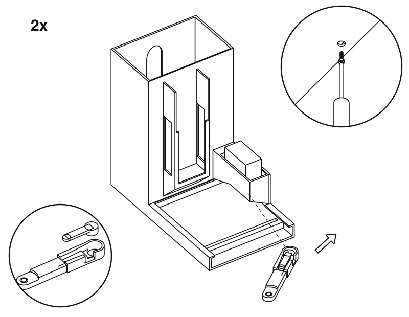
Press a horn into the groove in the arm. Slide the arm under the box and onto the shaft, then fix it with the horn screw, through the hole underneath the body.

8
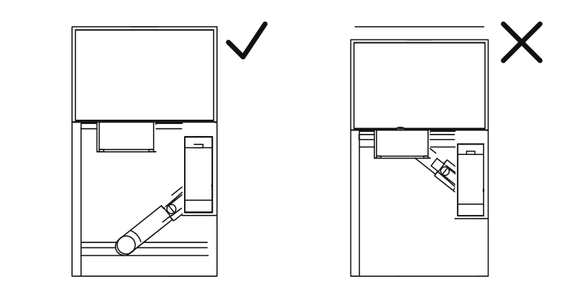
At rest, the arm points to the front and the pusher leaves the floor of the tower clear. If it does not, take the arm off and put it back on the shaft in the right position.

9
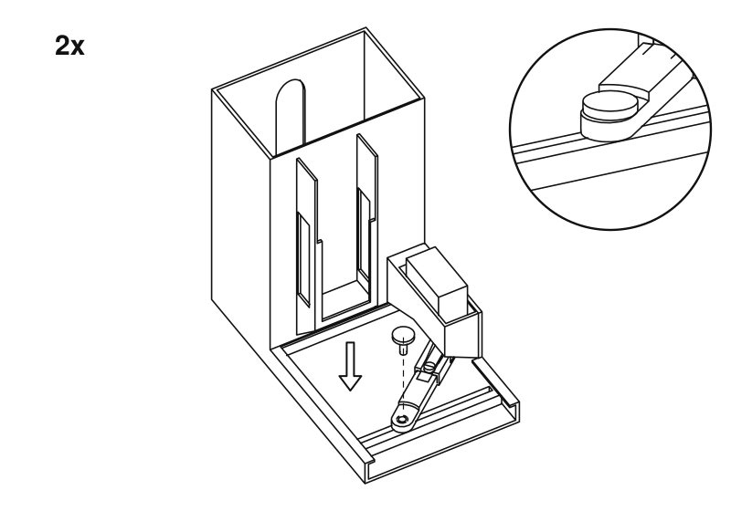
Drop the pin through the arm and into the slot, head up. It has to slide freely along the slot. If it binds, file the slot a little wider.

10
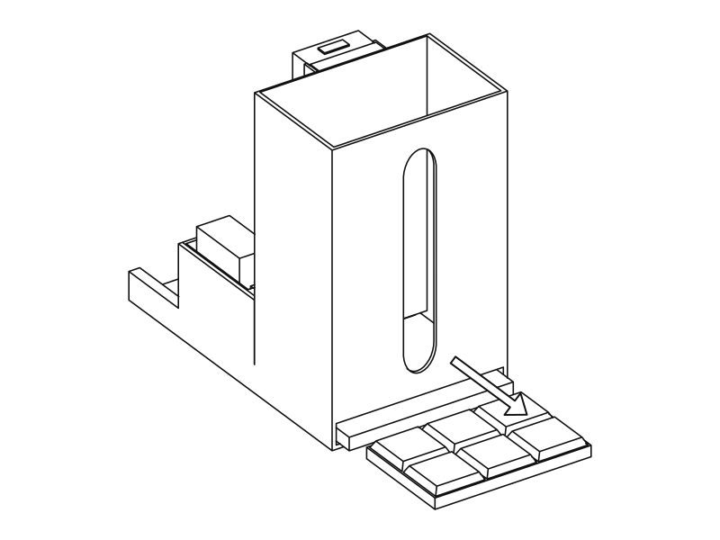
With the tower still empty, press
**Test dark cycle**and
**Test milk cycle**on the dashboard. The pusher should reach through the slot at the back, then return. Chocolate comes out here, so leave room for a cup.

11
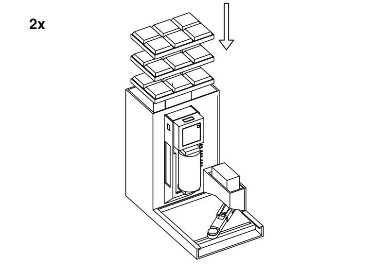
Stack the chocolate flat into the top of the tower. The window at the back shows how much is left. Tell the unit how much you loaded, on the dashboard.

Done. Now
[place an order](usage.md).

These drawings are generated from the same STL files you print. To change one, edit `tools/assembly/build.py` in the source repository and run it again.

