# Assemblage - Spenser - a developer's companion v1.0.0

## Assemblage

 
Cette page comprend des traductions de la langue source originale dans laquelle le guide a été rédigé. Des informations sur ces traductions et des instructions sur la manière de fournir un retour d'information sur les traductions sont disponibles [ici](translationinfo.md). 

Deux couloirs, un pour le chocolat noir et un pour le chocolat au lait. Tout ce qui est marqué **2x** se fait une fois par couloir.

Imprimez les [pièces 3D](hardware-3ddesign.md), achetez l'[électronique](hardware-bom.md), et commencez par mettre le [micrologiciel](firmware.md) sur le contrôleur.

Ces dessins ont été réalisés à partir des modèles 3D des pièces, et non photographiés sur une unité terminée. Si quelque chose ici ne correspond pas à ce que vous avez en main, merci de nous le [signaler](https://github.com/costateixeira/spenser/issues).

Vérifiez que vous avez tout. Les palonniers et les vis sont fournis avec les servos, et il vous faut aussi un câble USB-C. Un morceau de chocolat ne doit pas dépasser 60 × 39 mm et doit faire entre 5,5 et 7,5 mm d'épaisseur.

1
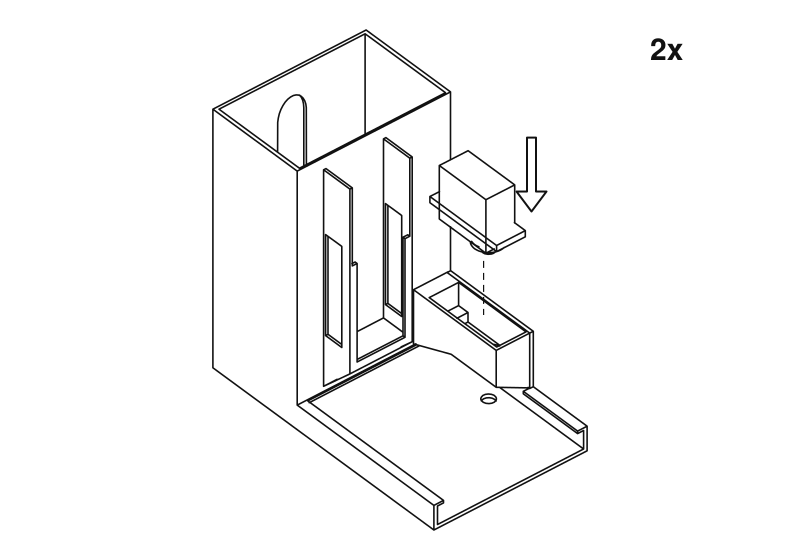
Descendez le servo dans le boîtier, arbre vers le bas, jusqu'à ce que ses oreilles reposent sur le rebord. L'arbre pointe vers le plateau.

2
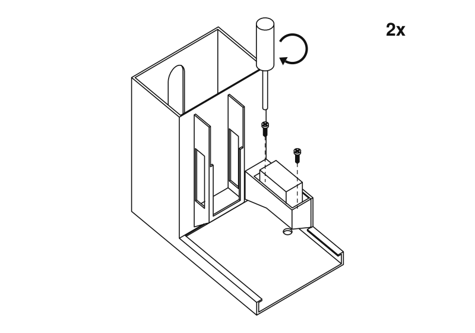
Fixez-le avec deux vis passées dans les oreilles. Serrez juste ce qu'il faut, sans forcer : elles entrent dans du plastique.

3
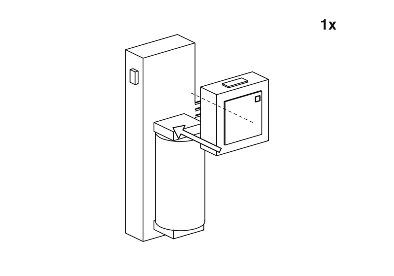
Enfoncez l'Atom sur l'extrémité de la base Atomic Motion opposée à la batterie.

4
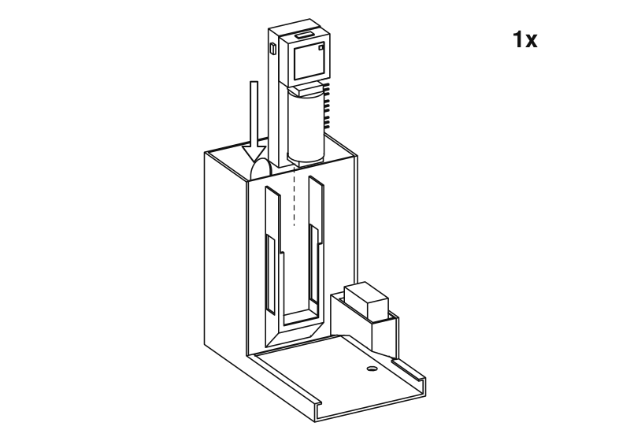
Faites glisser la base vers le bas dans la baie à l'avant d'une tour, côté batterie en premier, de sorte que l'Atom se retrouve en haut. La batterie et le bouton de l'Atom sont tournés vers le plateau, et les connecteurs des servos du côté du servo. Un seul corps en a besoin.

5
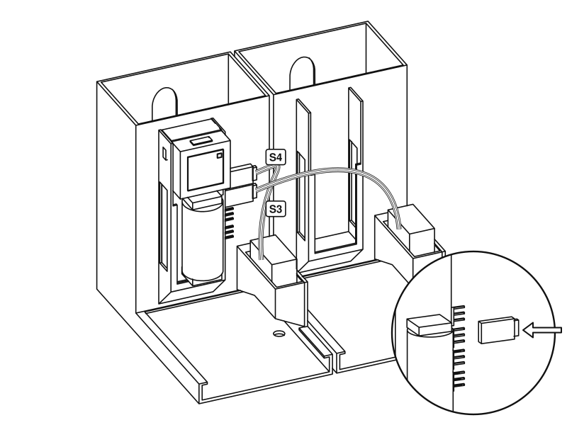
Placez les corps côte à côte. Enfoncez la fiche du servo du couloir chocolat noir sur le connecteur marqué S4 et celle du couloir chocolat au lait sur S3, que le micrologiciel appelle canaux 3 et 2. Le fil marron est la masse : alignez-le sur la marque de masse à côté du connecteur. Un autre choix peut être réglé sur le tableau de bord.

6
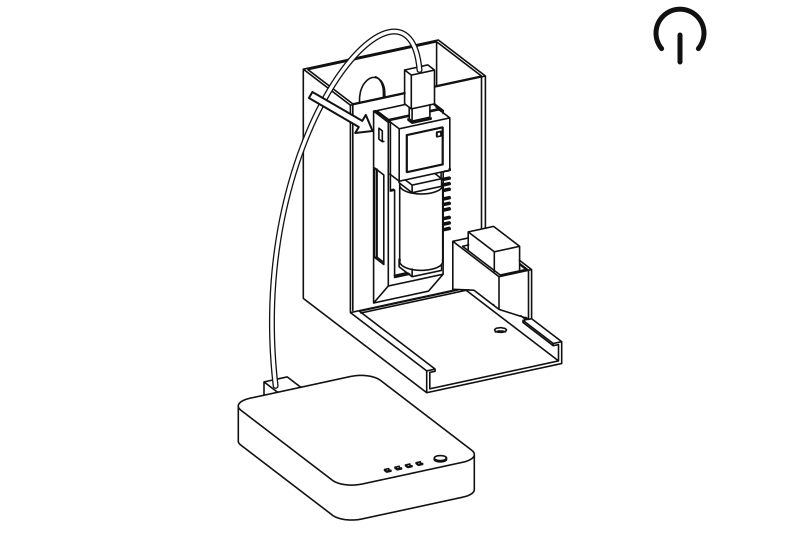
Branchez la batterie externe sur le port USB-C situé au-dessus de l'Atom et allumez la base. Ouvrez le tableau de bord et appuyez sur
**Move both to rest**. Ne tournez plus les servos à la main à partir de maintenant. La batterie de la base se recharge par le même câble.

7
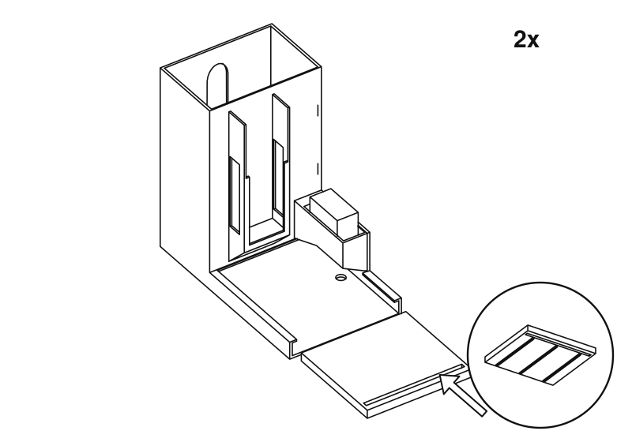
Engagez le poussoir dans la glissière par l'avant, nervures vers le bas et longue fente vers vous.

8
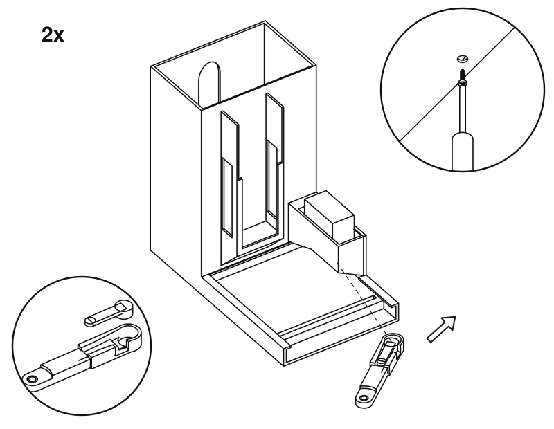
Enfoncez un palonnier dans la rainure du bras. Glissez le bras sous le boîtier et sur l'arbre, puis fixez-le avec la vis du palonnier, par le trou situé sous le corps.

8
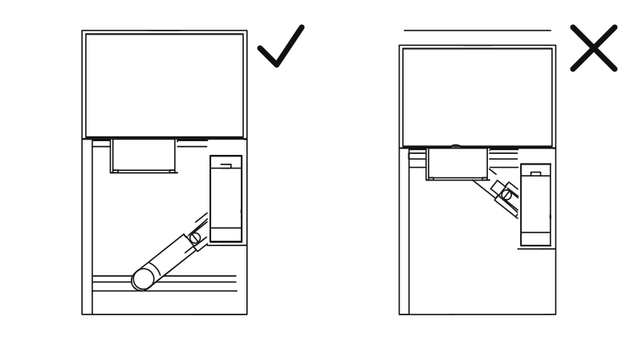
Au repos, le bras pointe vers l'avant et le poussoir laisse le fond de la tour dégagé. Sinon, retirez le bras et remettez-le sur l'arbre dans la bonne position.

9
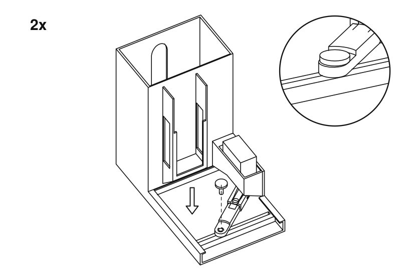
Laissez tomber la goupille à travers le bras et dans la fente, tête vers le haut. Elle doit coulisser librement le long de la fente. Si elle coince, limez un peu la fente pour l'élargir.

10
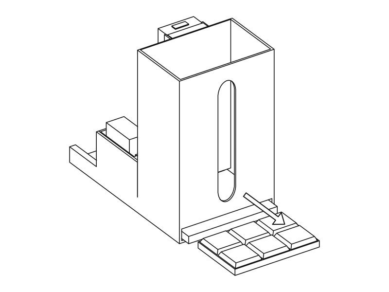
Tour encore vide, appuyez sur
**Test dark cycle**et
**Test milk cycle**sur le tableau de bord. Le poussoir doit passer par la fente à l'arrière, puis revenir. C'est par ici que sort le chocolat : laissez la place pour une tasse.

11
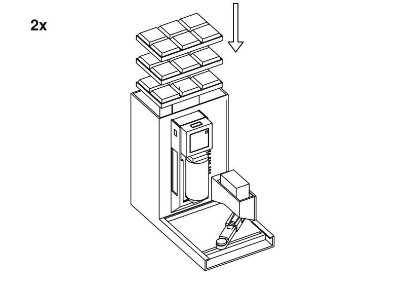
Empilez le chocolat à plat par le haut de la tour. La fenêtre à l'arrière montre ce qu'il reste. Indiquez à l'unité combien vous en avez chargé, sur le tableau de bord.

C'est fini. Maintenant,
[déposez une ordonnance](usage.md).

Ces dessins sont générés à partir des mêmes fichiers STL que ceux que vous imprimez. Pour en modifier un, éditez `tools/assembly/build.py` dans le dépôt source et relancez-le.

