# Montage - Spenser - a developer's companion v1.0.0

## Montage

 
Deze pagina bevat vertalingen van de oorspronkelijke taal waarin de gids is geschreven. Informatie over deze vertalingen en instructies voor feedback vindt u [hier](translationinfo.md). 

Twee banen, één voor pure chocolade en één voor melkchocolade. Alles wat met **2x** is gemarkeerd, gebeurt één keer per baan.

Print eerst de [3D-onderdelen](hardware-3ddesign.md), koop de [elektronica](hardware-bom.md), en zet de [firmware](firmware.md) op de controller.

Deze tekeningen zijn gemaakt op basis van de 3D-modellen van de onderdelen, niet gefotografeerd van een afgewerkte unit. Als iets hier niet overeenkomt met wat u in handen hebt, [laat het ons dan weten](https://github.com/costateixeira/spenser/issues).

Controleer of u alles hebt. De hoorns en schroeven worden met de servo's meegeleverd, en u hebt ook een USB-C-kabel nodig. Een stuk chocolade mag niet groter zijn dan 60 × 39 mm en moet tussen 5,5 en 7,5 mm dik zijn.

1
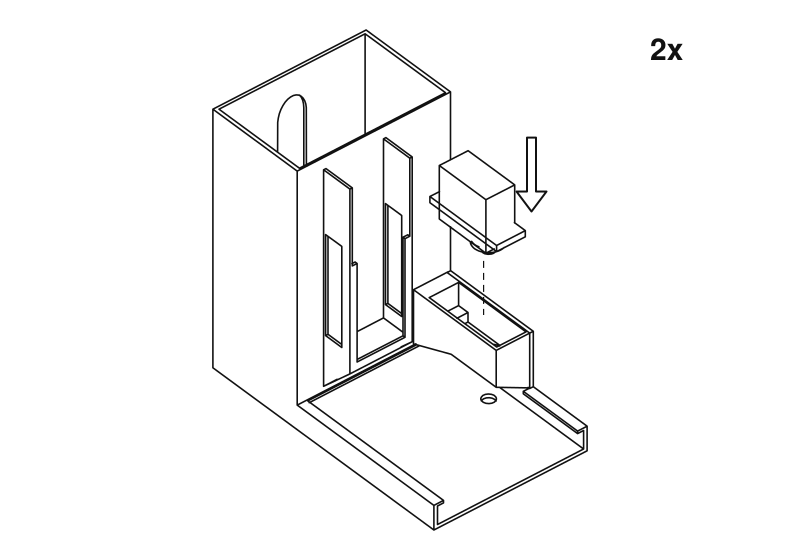
Laat de servo in de kast zakken, met de as naar beneden, tot de oren op de richel rusten. De as wijst naar het plateau.

2
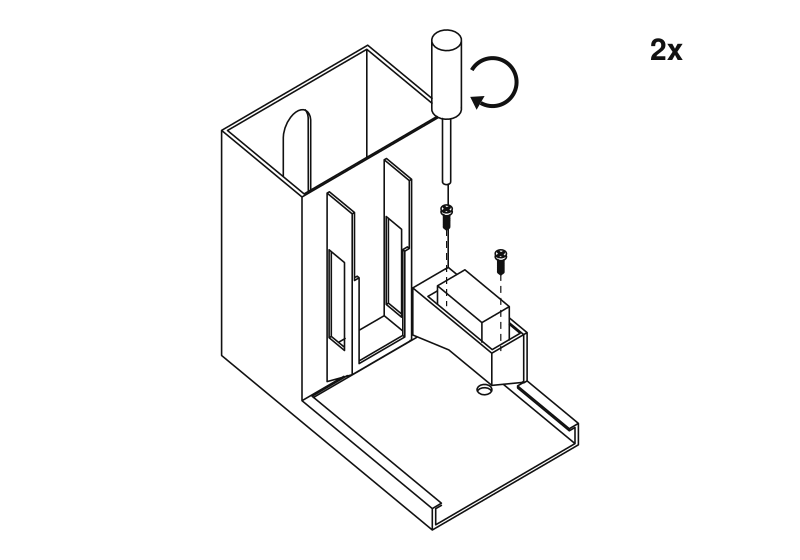
Zet hem vast met twee schroeven door de oren. Aangedraaid, niet muurvast: ze gaan in plastic.

3
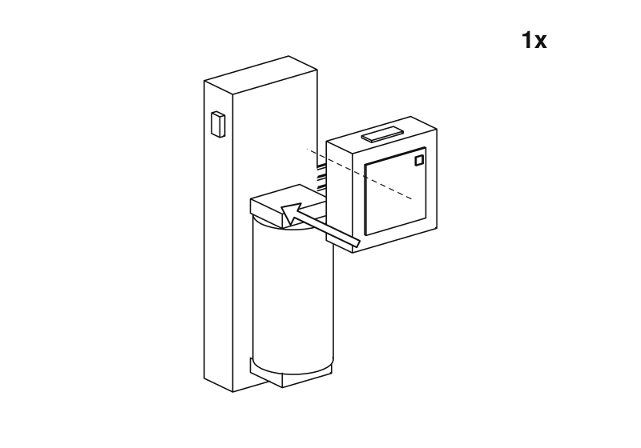
Druk de Atom op het uiteinde van de Atomic Motion-basis tegenover de batterij.

4
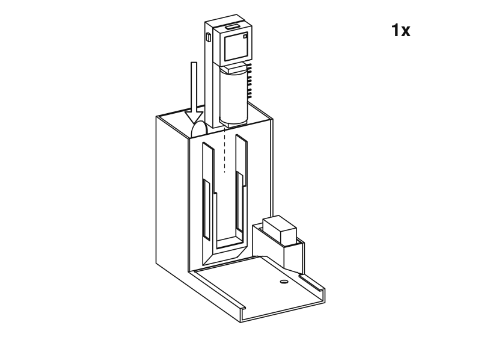
Schuif de basis omlaag in het vak aan de voorkant van één toren, met het batterij-uiteinde eerst, zodat de Atom bovenaan komt. De batterij en de knop van de Atom zijn naar de lade gericht, en de servoaansluitingen zitten aan de kant van de servo. Maar één behuizing heeft hem nodig.

5
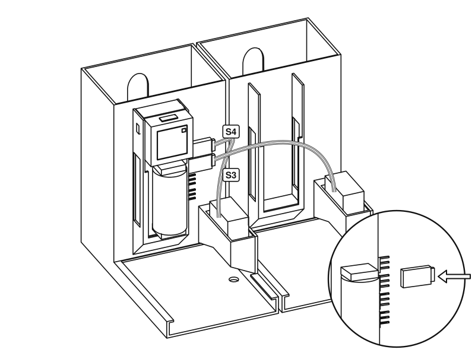
Zet de behuizingen naast elkaar. Druk de servostekker van de baan voor pure chocolade op de aansluiting gemarkeerd S4 en die van de baan voor melkchocolade op S3, wat de firmware kanaal 3 en 2 noemt. De bruine draad is massa: laat hem overeenkomen met het massateken naast de aansluiting. Op het dashboard kunt u een andere keuze instellen.

6
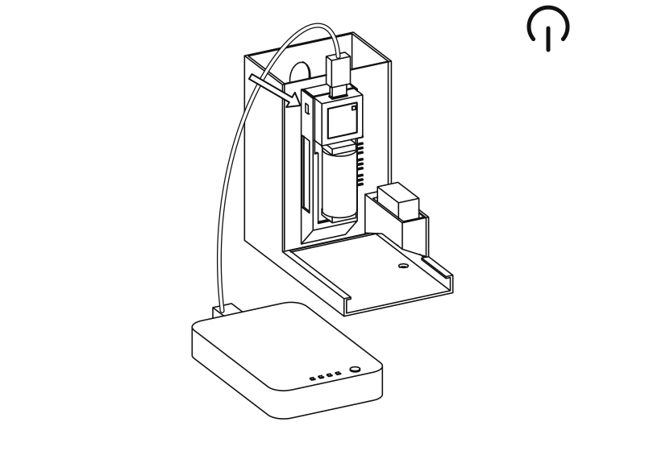
Sluit de powerbank aan op de USB-C-poort boven op de Atom en zet de basis aan. Open het dashboard en druk op
**Move both to rest**. Draai de servo's vanaf nu niet meer met de hand. De eigen batterij van de basis laadt via dezelfde kabel op.

7
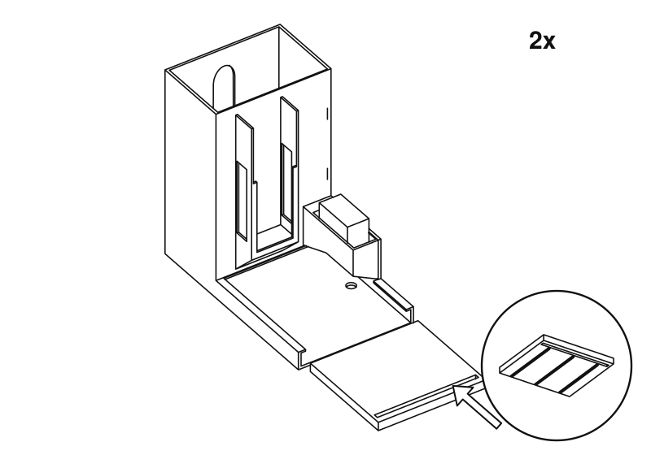
Schuif de duwer van voren in de geul, met de ribbels naar beneden en de lange sleuf naar u toe.

8
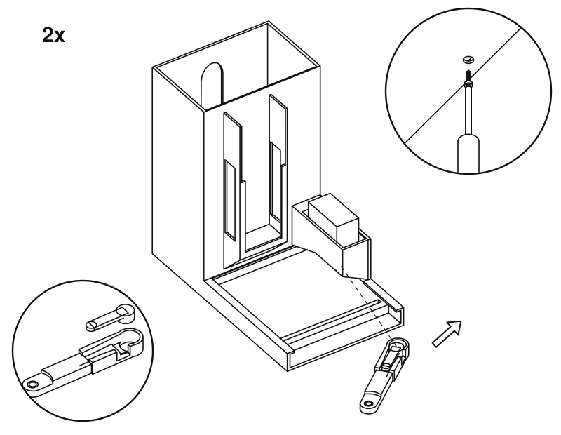
Druk een hoorn in de groef van de arm. Schuif de arm onder de kast en op de as, en zet hem dan vast met de hoornschroef, door het gat aan de onderkant van de behuizing.

8
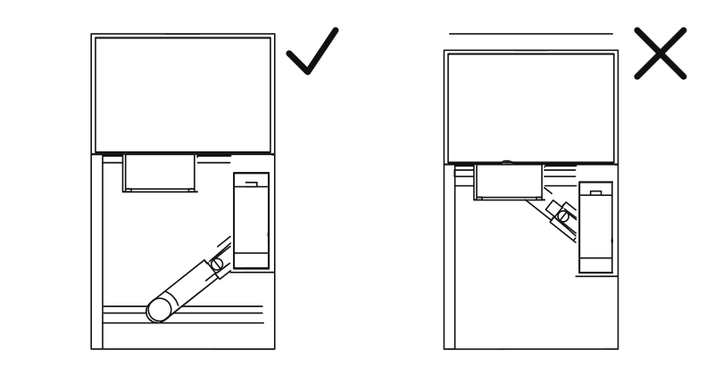
In rust wijst de arm naar voren en laat de duwer de vloer van de toren vrij. Is dat niet zo, haal de arm er dan af en zet hem in de juiste stand terug op de as.

9
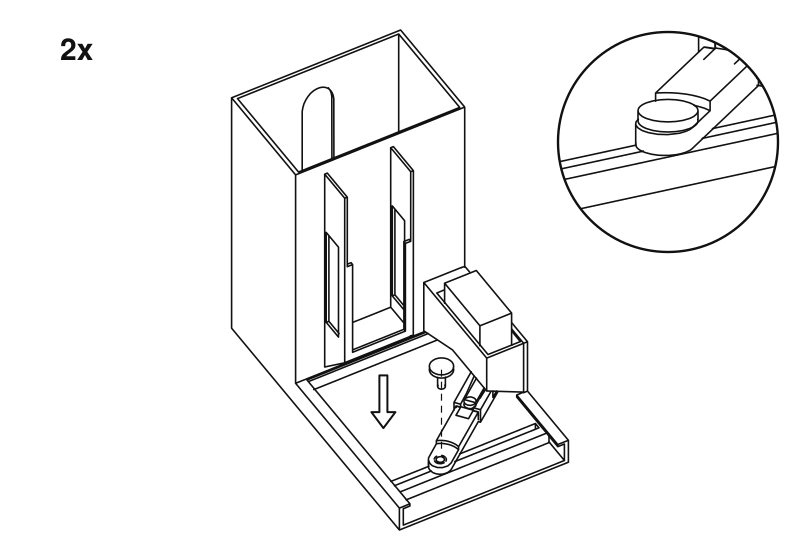
Laat de pen door de arm in de sleuf vallen, met de kop naar boven. Hij moet vrij langs de sleuf kunnen schuiven. Loopt hij vast, vijl de sleuf dan iets breder.

10
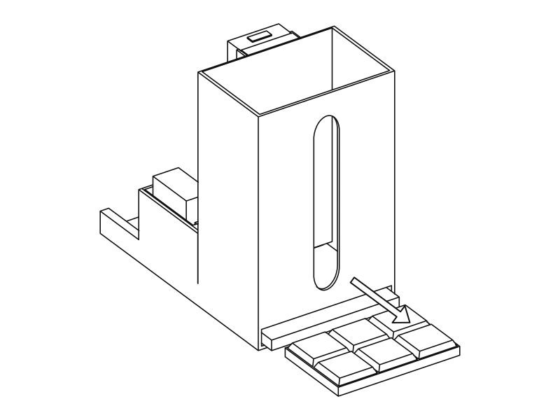
Druk, met de toren nog leeg, op het dashboard op
**Test dark cycle**en
**Test milk cycle**. De duwer moet door de sleuf aan de achterkant reiken en dan terugkeren. Hier komt de chocolade naar buiten, dus laat plaats voor een kopje.

11
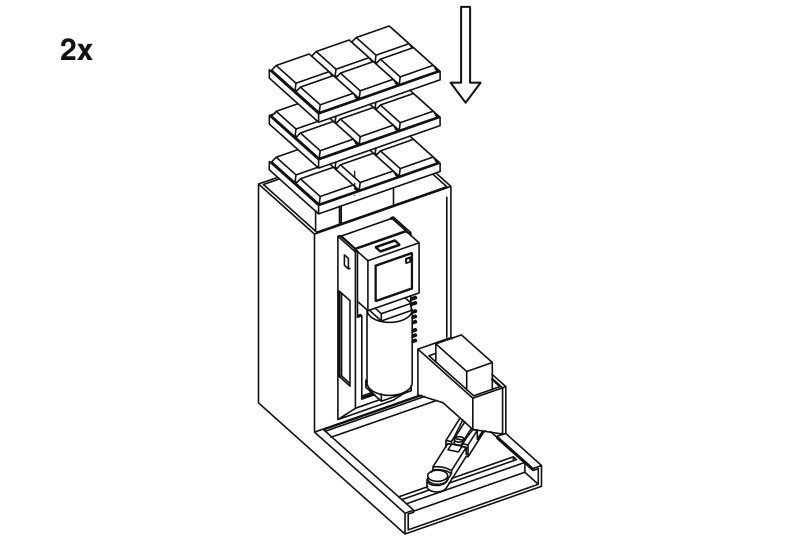
Stapel de chocolade plat in de bovenkant van de toren. Het venster aan de achterkant toont hoeveel er nog over is. Geef op het dashboard aan de unit door hoeveel u hebt geladen.

Klaar. Nu
[een order plaatsen](usage.md).

Deze tekeningen worden gegenereerd uit dezelfde STL-bestanden die u print. Om er een te wijzigen, past u `tools/assembly/build.py` in de bronrepository aan en voert u het opnieuw uit.

