# Montagem - Spenser - a developer's companion v1.0.0

## Montagem

 
Esta página inclui traduções a partir da língua original em que o guia foi criado. Informações sobre estas traduções e instruções para fornecer feedback podem ser encontradas [aqui](translationinfo.md). 

Duas calhas, uma para chocolate negro e outra para chocolate de leite. Tudo o que estiver marcado com **2x** é feito uma vez para cada calha.

Imprima as [peças 3D](hardware-3ddesign.md), compre a [eletrónica](hardware-bom.md) e coloque primeiro o [firmware](firmware.md) no controlador.

Estes desenhos foram feitos a partir dos modelos 3D das peças, não fotografados de uma unidade acabada. Se algo aqui não corresponder ao que tem nas mãos, [diga-nos](https://github.com/costateixeira/spenser/issues).

Verifique se tem tudo. As cruzetas e os parafusos vêm com os servos, e precisa também de um cabo USB-C. Uma peça de chocolate não pode ser maior do que 60 × 39 mm e deve ter entre 5,5 e 7,5 mm de espessura.

1
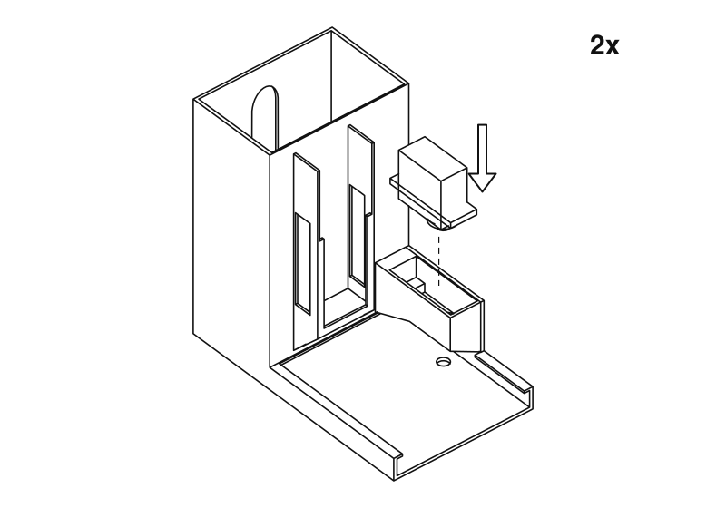
Desça o servo para dentro da caixa, com o veio para baixo, até as orelhas assentarem no rebordo. O veio aponta para o tabuleiro.

2
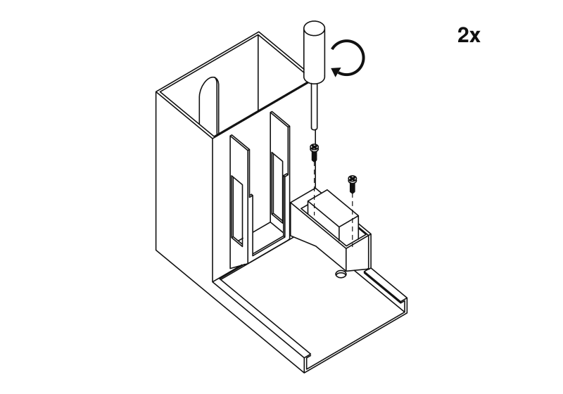
Fixe-o com dois parafusos através das orelhas. Justos, não apertados: estão a entrar em plástico.

3
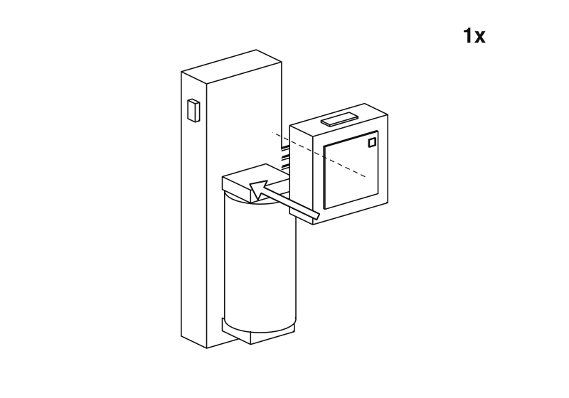
Encaixe o Atom na extremidade da base Atomic Motion oposta à bateria.

4
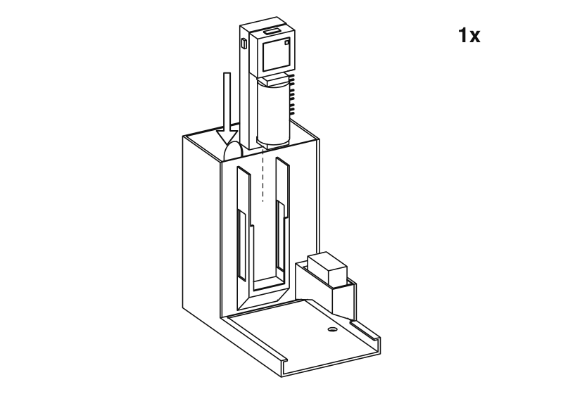
Faça deslizar a base para baixo no compartimento da frente de uma das torres, com a extremidade da bateria primeiro, de modo que o Atom fique em cima. A bateria e o botão do Atom ficam virados para o tabuleiro, e os conectores dos servos do lado do servo. Só um dos corpos precisa dela.

5
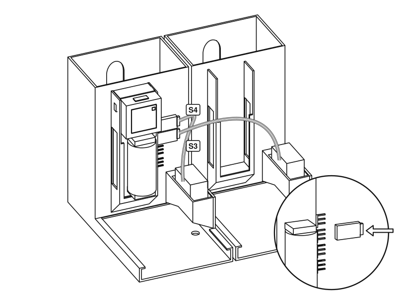
Coloque os corpos lado a lado. Encaixe a ficha do servo da calha do chocolate negro no conector marcado S4 e a da calha do chocolate de leite no S3, a que o firmware chama canais 3 e 2. O fio castanho é a terra: alinhe-o com a marca de terra junto ao conector. Pode escolher outros no painel.

6
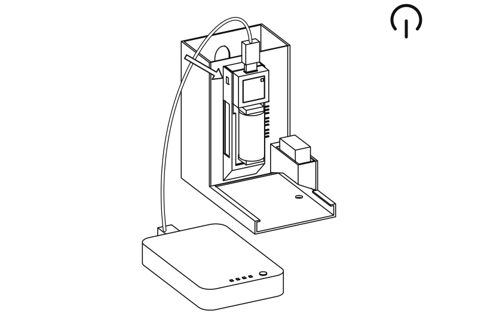
Ligue a bateria externa à porta USB-C em cima do Atom e ligue o interruptor da base. Abra o painel e prima
**Move both to rest**. A partir daqui, não rode os servos à mão. A bateria da própria base carrega pelo mesmo cabo.

7
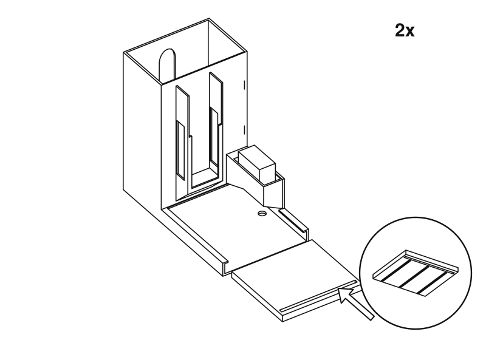
Deslize o empurrador para dentro do canal pela frente, com as nervuras para baixo e a ranhura comprida virada para si.

8
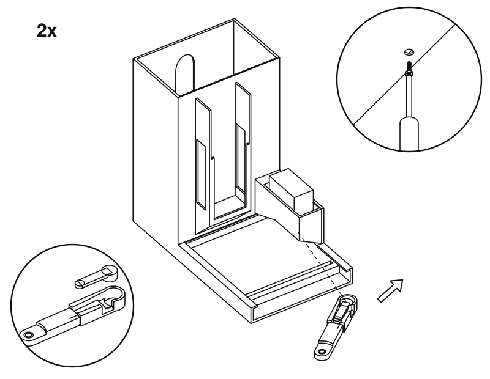
Encaixe uma cruzeta no sulco do braço, pressionando. Deslize o braço por baixo da caixa e para o veio, e depois fixe-o com o parafuso da cruzeta, através do orifício por baixo do corpo.

8
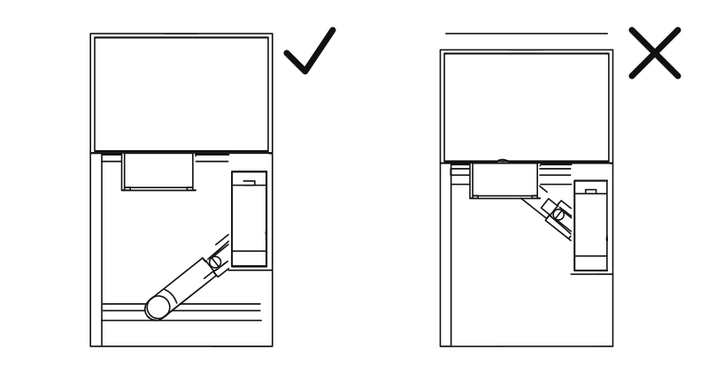
Em repouso, o braço aponta para a frente e o empurrador deixa livre o fundo da torre. Se não for assim, retire o braço e volte a colocá-lo no veio na posição correta.

9
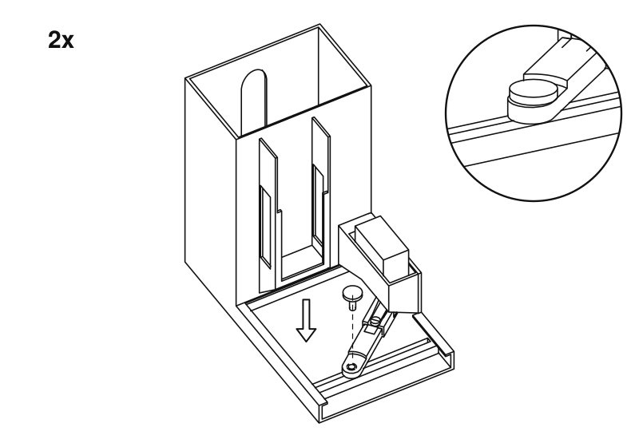
Deixe cair o pino através do braço e para dentro da ranhura, com a cabeça para cima. Tem de deslizar livremente ao longo da ranhura. Se prender, lime a ranhura para a alargar um pouco.

10
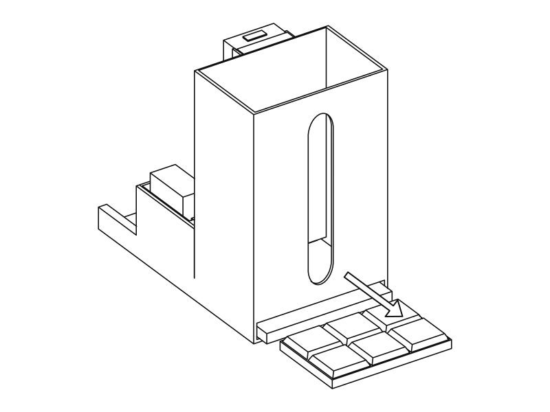
Com a torre ainda vazia, prima
**Test dark cycle**e
**Test milk cycle**no painel. O empurrador deve passar pela ranhura na parte de trás e depois regressar. É aqui que sai o chocolate, por isso deixe espaço para um copo.

11
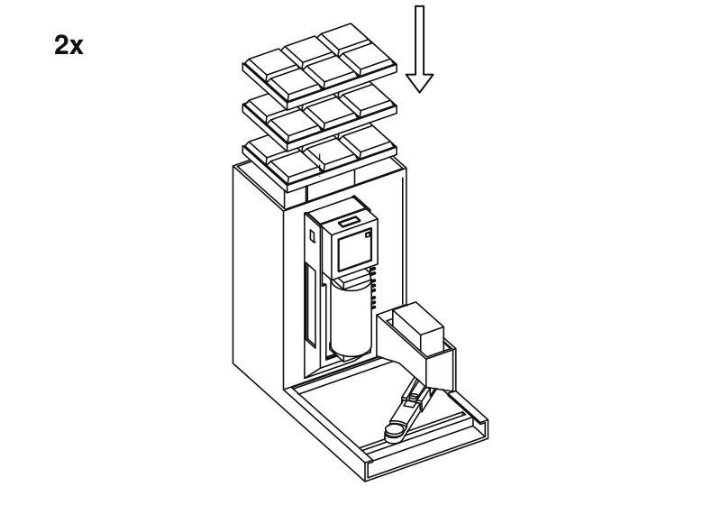
Empilhe o chocolate na horizontal pelo topo da torre. A janela na parte de trás mostra quanto resta. Indique à unidade quanto carregou, no painel.

Pronto. Agora
[emita uma prescrição](usage.md).

Estes desenhos são gerados a partir dos mesmos ficheiros STL que imprime. Para alterar um deles, edite `tools/assembly/build.py` no repositório de código e volte a executá-lo.

