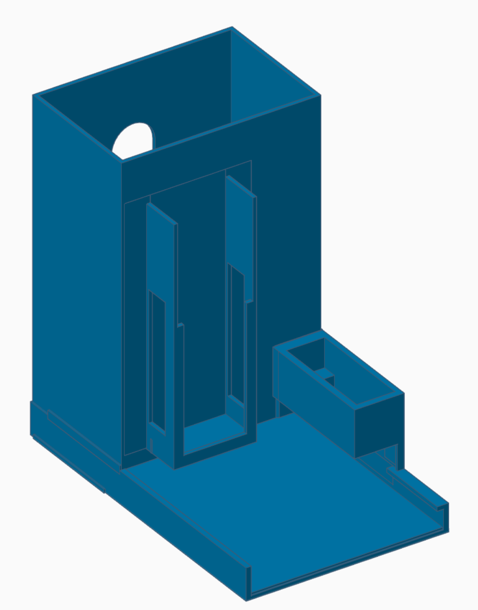
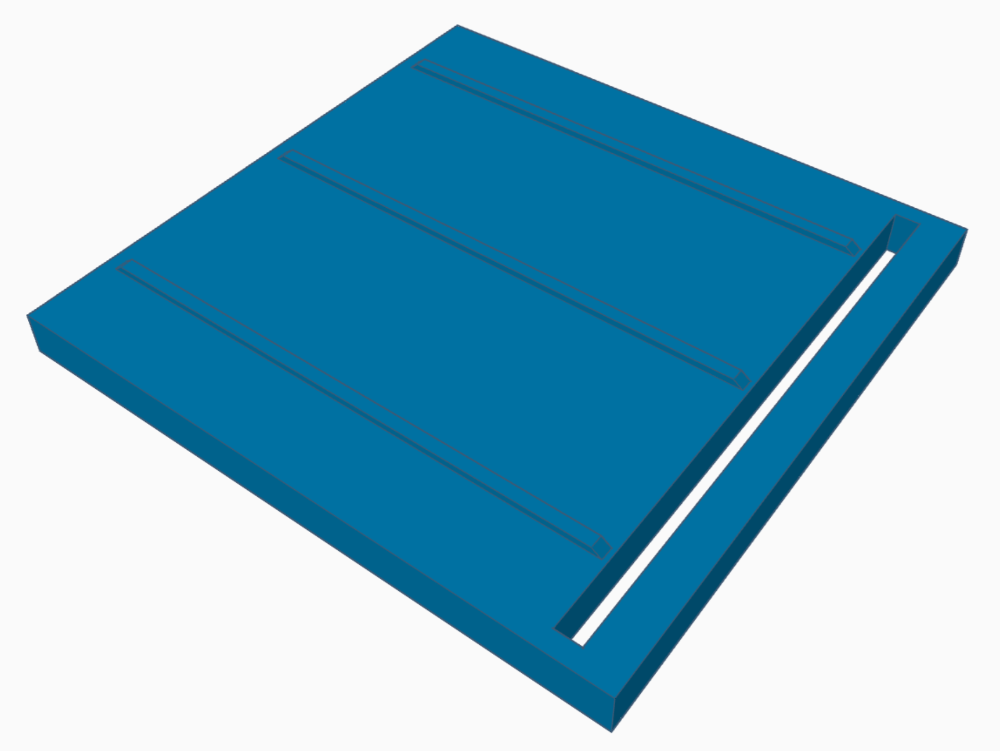
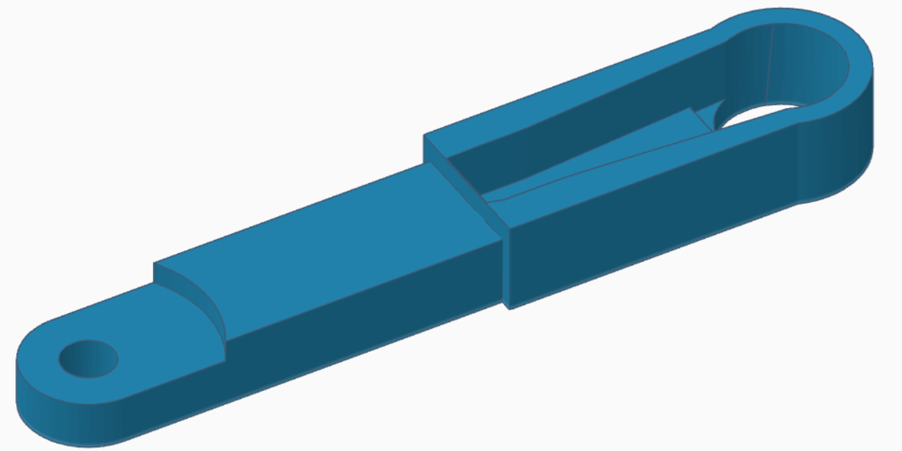
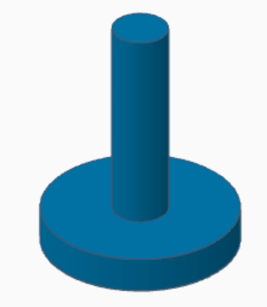

# Peças para impressão 3D - Spenser - a developer's companion v1.0.0

## Peças para impressão 3D

 
Esta página inclui traduções a partir da língua original em que o guia foi criado. Informações sobre estas traduções e instruções para fornecer feedback podem ser encontradas [aqui](translationinfo.md). 

Seguem-se as peças 3D usadas para construir o **Spenser**.

### Descrição

| | | | |
| :--- | :--- | :--- | :--- |
| **Corpo** |  | Segura a pilha de chocolates, o servomotor e as guias de deslizamento, sobre a sua própria base. | [STL](spenser-body.stl) |
| **Empurrador** |  | Desliza ao longo das guias e empurra um chocolate para fora. | [STL](spenser-pusher.stl) |
| **Braço** |  | Fixa-se à cruzeta do servo e move o empurrador. | [STL](spenser-arm.stl) |
| **Pino** |  | Eixo que liga o braço ao empurrador. | [STL](spenser-pin.stl) |

### Para chocolates mais pequenos

A pista acima aceita um pedaço até 60 × 39 mm, o que serve um napolitain belga. Um napolitain suíço é mais pequeno — um Lindt Napolitain tem cerca de 40 × 25 mm — e fica com espaço para se mexer. A folga de 9 mm ao longo do empurrão é a que importa: basta para um pedaço escorregar para a frente por baixo da parede de retenção, onde o empurrador o encontra de topo.

Estas são as mesmas peças com a pista cortada 17,5 mm mais estreita, 9 mm menos funda e a guia 20,2 mm mais curta, pelo que aceitam um pedaço **até 40 × 30 mm**, com a mesma espessura de 5,5 a 7,5 mm. Meça um pedaço antes de imprimir: 30 mm é o limite ao longo do empurrão.

A profundidade é a medida cortada ao pedaço, e é exacta. A largura não: é definida pelo encaixe onde desce a Atomic Motion Base, de 24 mm para um módulo de 24 mm, e pelo alojamento do servo ao lado, de 12,26 mm para uma caixa de 12,2. Ambos ficam entre as mesmas duas paredes laterais da pista e não se pode tirar nada de nenhum deles, pelo que 17,5 mm é tudo o que estas peças podem ceder em largura. Um pedaço de 40 mm fica com 2,5 mm de folga lateral no que resta, e mesmo um ajuste largo não custaria nada: um pedaço de 30 × 40 não roda numa pista de 31 mm de fundo, por mais larga que ela seja.

Duas coisas mudam na construção. Defina `anglePush=78,6` nesta unidade, em vez do valor por omissão de 77. E monte o braço de modo a ficar, em repouso, cerca de 44,5° recuado em relação à perpendicular à pista, e não a esquadria: isso recua todo o percurso e é o que permite o corpo ser tão curto. A verificação é que, em repouso, a face de empurrar fique logo atrás do empilhamento de chocolate. Os 26,7 mm saem de trás, atrás do empurrador, e não da boca: o pedaço sai pela outra extremidade, e 6,5 mm deles voltam a entrar por baixo do servo, que é como o seu encaixe fica encostado à face traseira. O próprio servo entra virado ao contrário em relação à unidade padrão, para que o cabo saia por trás; o pino vai então na segunda ranhura do empurrador, que retira os 5 mm que a caixa virada desloca o veio. O pino tem aqui uma peça própria e não precisa de ser furado: o orifício no braço tem 3,1 mm nestes ficheiros contra 2,76 no braço padrão, e o próprio pino tem 2,3 mm em vez de 2,55. Foi preciso mexer nas duas metades. Um orifício pequeno é impresso abaixo da medida e um eixo pequeno acima da sua, e juntos consumiram os 0,44 mm de folga que o desenho tinha, pelo que o pino não entrava; agora há 0,79 mm. O pino padrão não muda — se construir esse, fure o braço padrão a 2,6 mm.

Para outro tamanho de pedaço, [`tools/resize/build.py`](https://github.com/costateixeira/spenser/blob/master/tools/resize/build.py) corta estas três peças à medida dele e mostra o que fica o curso. O pedaço indica-se como largura da pista × ao longo dela × espessura, pelo que `--piece 40x30x7 --name small` é esta variante; sem nada depois do comando, o script toma a mignonette belga para a qual as peças acima já estão cortadas e diz que não há nada a cortar.

| | | |
| :--- | :--- | :--- |
| **Corpo** | Uma pista de 43,5 × 31 mm em vez de 61 × 40; 46,5 × 80,8 × 105 mm no total. O encaixe do módulo mantém os seus 24 mm completos e o servo os seus 12,26, e nenhuma altura nele se move: a saliência que segura o empurrador, a caixa do servo e a abertura de saída ficam onde o corpo padrão as tem. O servo entra virado ao contrário, pelo que o seu cabo sai pela traseira da unidade em vez de ficar voltado para o depósito, e todo o seu encaixe fica 6,5 mm mais atrás para que o veio se mantenha perto de onde estava. O cabo passa então a ter de atravessar todo o comprimento da torre, pelo que a parede lateral do depósito avança 13,0 mm por cima dela, tão alta como a calha do módulo do lado oposto e com a mesma janela, para o cabo encostar. | [STL](spenser-body-small.stl) |
| **Empurrador** | 42,4 × 46 mm, para corresponder à pista mais estreita, com duas ranhuras de 2,55 mm para o pino: o pino entra em qualquer uma delas, e a segunda, 5 mm mais para dentro, mantém o empurrador 5 mm mais atrás durante todo o movimento, que é a que este corpo pede, estando o servo virado ao contrário. | [STL](spenser-pusher-small.stl) |
| **Braço** | 26,75 mm entre os furos em vez de 41, o que dá um curso de 33,76 mm com`anglePush=78,6`, à medida da pista menos funda. | [STL](spenser-arm-small.stl) |
| **Pino** | 2,3 mm de eixo em vez de 2,55, que é a outra metade do ajuste com o braço. | [STL](spenser-pin-small.stl) |

### Lista de materiais

**As quantidades indicadas são para o dispensador de 2 posições.**

| | | |
| :--- | :--- | :--- |
| Corpo | Segura os chocolates, o motor e as guias de deslizamento | 2 |
| Braço | Braço rotativo fixado ao servo | 2 |
| Pino | Liga o braço ao empurrador | 2 |
| Empurrador | Empurra um chocolate para fora | 2 |

